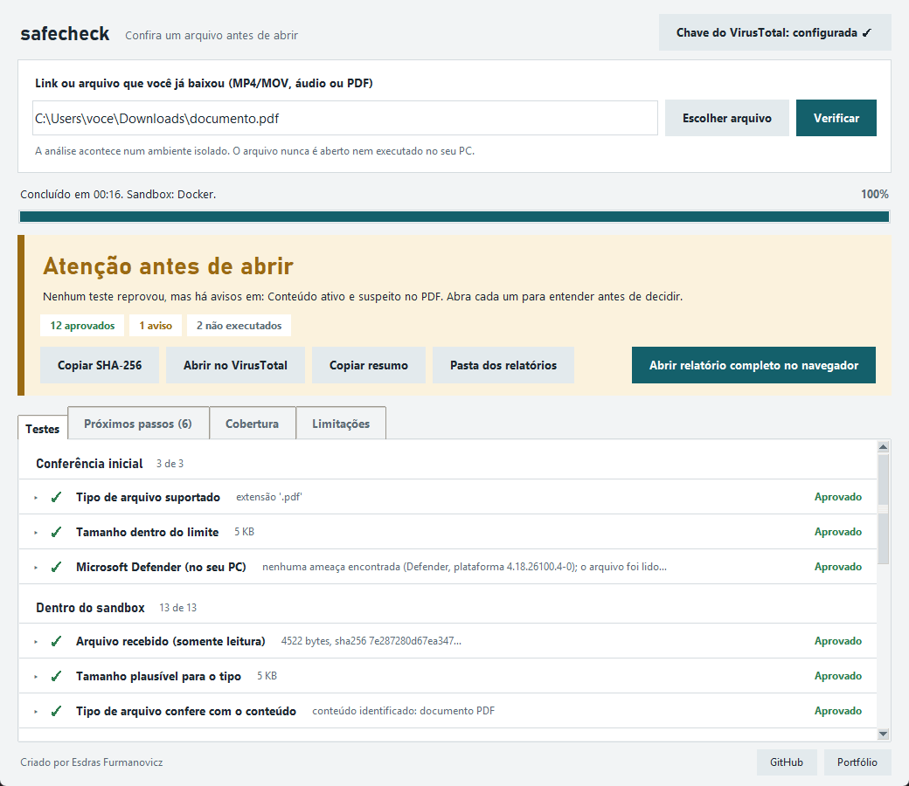
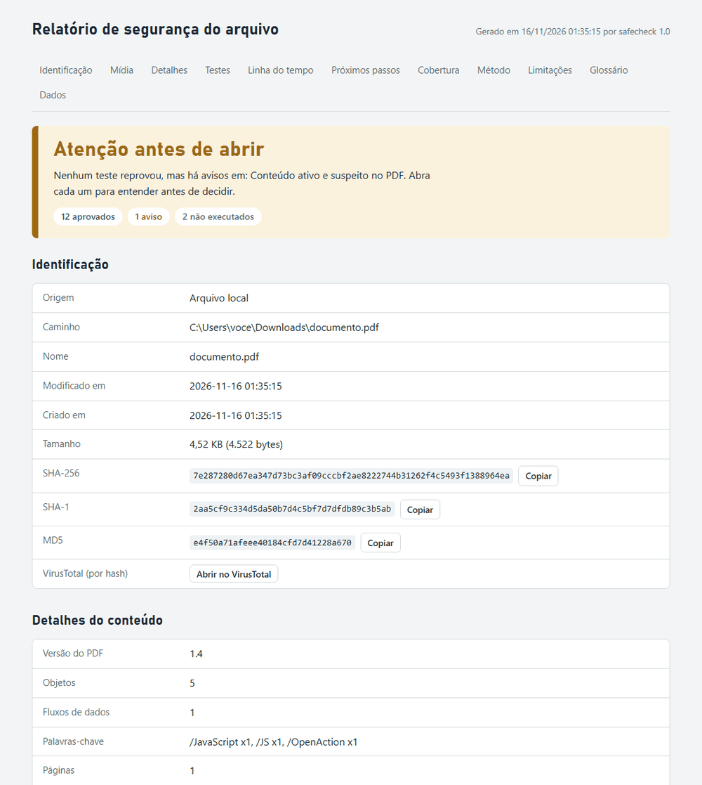

# safecheck

<p align="center">
  
</p>

<p align="center">
  <a href="https://github.com/esdrasfurmanovicz/Safecheck/actions/workflows/tests.yml"></a>
  
  
  
</p>

<p align="center"><a href="README.md">Português</a> · <b>English</b></p>

**Private, local triage of downloaded files, before you open them.** Paste a link or pick a file and safecheck analyzes it inside a disposable sandbox (a Docker container): it works out the real file type from its content, runs antivirus, YARA rules and format validators, and gives you a verdict, a full HTML report and a guide to what else you can do. It currently supports **video and audio (MP4, MOV, MP3, AAC, WAV, FLAC, OGG) and PDF**.

> Portfolio project. It started from a real need: checking large files downloaded from file-hosting sites before opening them, without uploading them to third parties (VirusTotal does not accept files above roughly 650 MB).

> **Disclaimer:** safecheck **never claims a file is safe**. It records what was checked and what was not. Finding nothing does not mean there is nothing: unknown malware, bugs in readers and players, and behavior at run time are out of reach. Use it as triage, alongside VirusTotal, not as a replacement for an antivirus or for common sense.

> **Note:** the interface and the reports are in Portuguese (pt-BR), and so are the screenshots.

## Why use it

- **Private, with no practical size limit.** The file is never sent to third parties. Only its SHA-256 hash goes to VirusTotal, and only if you set up a key. Multi-GB files work (the program's limit is 3 GB).
- **It does not trust the extension.** The type comes from the content: an `.mp3` that is really a PDF, an executable, a ZIP or an HTML page is rejected as a disguise.
- **Several layers, and it shows where they disagree.** ClamAV, Microsoft Defender (on your PC), YARA rules, per-format validators and second-opinion tools.
- **Honest about its limits.** Every report lists what was tested, what was left out and what else to do, depending on your case.
- **Verified download.** If the analysis was by link, the program downloads the file to your PC and only finishes if the SHA-256 matches the analyzed file.

## Getting started

**Requirements**

- **Python 3.11 or newer.** Standard library only, no `pip install`. The window uses Tkinter, which ships with Python on Windows and macOS (on Linux: `python3-tk`).
- **Guided setup.** On startup the program checks what is missing (Tkinter, Docker stopped or without permission), lists it and asks whether it may install. If you decline, it exits. Works in the terminal and in the window (on Linux it asks for the administrator password).
- **[Docker Desktop](https://www.docker.com/products/docker-desktop/)**, open and running. It is the sandbox that covers every type and every test. Alternative for MP4 and MOV: Windows Sandbox (Windows Pro or Enterprise).
- Optional: Microsoft Defender on Windows (second antivirus engine) and a free [VirusTotal](https://www.virustotal.com/) key.
- Tested on **Windows 11 with Docker Desktop**. Linux and macOS should work with Docker but have not been tested.

**Install and run**

```bash
git clone https://github.com/esdrasfurmanovicz/Safecheck.git
cd Safecheck
python safecheck_gui.py        # opens the window (on Windows, double-click safecheck.pyw)
```

Paste a link or use **Escolher arquivo** ("Choose file"), then click **Verificar** ("Check").

> The **first analysis builds the sandbox's Docker image** (ClamAV, ffmpeg, YARA and other tools, about **1.4 GB**) and takes several minutes. It needs internet access. Later runs are fast.

## Usage

**Window.** The list of tests is shown up front, grouped by phase, with progress and elapsed time. Each test is marked (✓ ✗ ! –) as soon as it finishes, and a click (or Enter) opens what it does and its result. At the end a verdict card appears with actions (copy the SHA-256, open on VirusTotal, copy a summary, open the reports folder and the full report in the browser) and the tabs Tests, Next steps, Coverage and Limitations. Failed tests and warnings open on their own.

**Terminal.**

```bash
python safecheck.py "https://www.mediafire.com/file/.../document.pdf/file"   # by link
python safecheck.py "C:\Users\you\Downloads\song.mp3"                        # already-downloaded file
python safecheck.py --open "..."      # opens the HTML report in the browser when done
python safecheck.py --reports FOLDER  # writes the reports to another folder
```

**VirusTotal key.** The **Chave do VirusTotal** button (top right) lets you paste, test, save and remove the free key. On Windows it is stored **encrypted for your user account** (DPAPI); on other systems, in a file with restricted permissions, unencrypted. The `VT_API_KEY` environment variable takes precedence. The key never reaches the sandbox.

**Download the verified file.** When the analysis was by link and no test failed, the verdict card shows a download button: **green** if everything passed, **amber** ("Baixar mesmo com avisos", download despite warnings) if there were warnings. Clicking **asks for confirmation**; with warnings, the prompt lists each one and the default answer is "No". The program downloads with resume, writes to a `.part` file and only finishes if the SHA-256 matches the analyzed file (otherwise it deletes the download and blocks it). On Windows, Defender scans the saved file.

**Where the data lives.** Reports (`.html` and `.json`): `%LOCALAPPDATA%\safecheck\reports` on Windows and `~/.local/share/safecheck/reports` on Linux and macOS, outside the repository (the window has a **Pasta dos relatórios** button). Key: `%APPDATA%\safecheck\config.json` or `~/.config/safecheck/config.json`.

## Supported types

The type is detected from the **content** (leading bytes), not from the extension.

| Format | Status |
|---|---|
| MP4, MOV, M4V, M4A | **ready** |
| MP3, AAC, WAV, FLAC, OGG | **ready** |
| PDF | **ready** |
| Office (DOCX, XLSX, PPTX, DOC, XLS), RTF | planned (macros, remote templates, OLE objects) |
| ZIP, RAR, 7z | planned (list without extracting; decompression bombs, executables inside) |
| MKV, WebM, AVI | planned |
| Images (JPG, PNG, GIF, WebP, SVG) | planned |
| **EXE, MSI, APK, DMG, scripts (`.js`, `.vbs`, `.ps1`, `.bat`), `.lnk` shortcuts, ISO** | **rejected on purpose**: static analysis alone gives false assurance for these. The program warns and points to VirusTotal and Defender |

## What is checked

| Stage | What runs |
|---|---|
| **On your PC, before downloading** | HTTPS, domain without IP/punycode/user info in the URL, public DNS, HTTPS-only redirects, announced type and size. For a local file: extension, size and **Microsoft Defender** (it reads the file, it does not open it) |
| **MP4, MOV, M4A** | box structure, internal tables (impossible counts, offsets outside the file), metadata, `ffprobe` and a decode sample |
| **Audio** | frames and blocks consistent with the size, appended data or junk in the middle, malformed ID3 tags, cover art that is not an image, full decode, `flac -t`, `mp3val`, `ogginfo` |
| **PDF** | header and `%%EOF`, structure, active content (`/JavaScript`, `/OpenAction`, `/Launch`, attachments, obfuscated names, suspicious links), compressed streams **opened with hard limits** (decompression-bomb protection), `qpdf`, `mutool`, `pdfinfo`, `pdfdetach` |
| **All types** | type vs. extension, embedded executable or RAR, **ClamAV** (also warns about encrypted documents and files that exceeded a limit), community **YARA rules** (with the offset where they matched), `exiftool`, and as second opinions: `file`, `binwalk`, `pdfid`, `pdf-parser`, `pdfresurrect`, `steghide` (WAV), `ssdeep` |
| **VirusTotal** | hash lookup. A hash VirusTotal has "never seen" is informational only |

## How it works and security

```
link or file ─▶ checks on the PC ─▶ Docker sandbox (download + tests) ─▶ VirusTotal (hash only) ─▶ verdict + report
```

- The sandbox is a **disposable** container: no root, no capabilities, read-only filesystem, memory limit (3 GB) and process limit. The network is on, because it is needed to download the file and to update ClamAV signatures.
- A local file enters the sandbox through a hard link, mounted **read-only**. It is never opened or executed on your PC.
- The report and the window only read what the sandbox returns (a JSON). Nothing that came from the file is executed.

| What leaves your computer | Where to |
|---|---|
| The link (to download inside the sandbox) | the file's server |
| The file's SHA-256 (only if you set a key) | VirusTotal |
| ClamAV signature updates | ClamAV servers |
| Package and rule downloads while building the image | Debian and GitHub repositories |
| **The file itself** | **never** |

## Report

Each analysis writes a **self-contained** HTML report (no external resources, follows the system's light or dark mode): verdict, file identification (SHA-256, SHA-1, MD5), content details, every test with "what it does" and "what it means if it fails", timeline, next steps, coverage, environment and method, limitations, glossary and the raw data. Link parameters (tokens) are left out of it.

<p align="center">
  
</p>

## Limitations

The program **does not cover everything**, and every report includes the coverage table. The main points:

- **Unknown malware gets through.** Antivirus and YARA only detect what they already know. The program's own PDF analysis (active content) and structure checks are what work without a signature, but they are not exhaustive.
- **Bugs in your reader or player** (for example, a video crafted to exploit a codec) and **behavior at run time** are out of scope: the file is never executed or played in full.
- **Encrypted PDFs** cannot be inspected, not even by an antivirus.
- A server may hand the sandbox a different file than it would hand you (the download on your PC checks the hash to catch this). Links with a captcha or password do not work, and the MediaFire page resolution uses a regex that may break if the site changes.
- The program **does not assess the legality** of the content.

## FAQ

**The first run is slow or Docker shows an error.** The sandbox image is built once (several minutes, 1.4 GB). Make sure Docker Desktop is **open and running**: the program tells you if it is not.

**The download is cut off or hangs.** The program waits 60 s without data, retries resuming from where it dropped and, if the server cuts the connection 3 times in a row without sending anything, gives up and says at which byte it stopped. In the window it then tries to download through the Docker container, which uses a different network route. If both routes fail, the cut comes from the server (for example, MediaFire's limits on large files): try again later or on another network.

**A YARA warning appeared, such as `maldoc_getEIP_method_1`. What is it?** It is a rule from Yara-Rules, by Didier Stevens, that looks for 6 bytes typical of shellcode in documents. It is a heuristic, not the identification of a specific malware. In **video**, a document rule that matches inside the data or the index is almost always a coincidence and shows up as information only; in a PDF, free space or appended data remains a warning. The report shows the exact offset.

**Why is my `.exe` rejected?** Because static analysis alone gives false assurance for executables. Use VirusTotal and Defender.

**VirusTotal says it does not know the file.** That is normal for personal or large files: the lookup worked, but nobody ever uploaded that file. It does not indicate a problem, and it does not confirm the file is clean either.

## Tests and development

```bash
python -m unittest discover -s tests -v    # 87 tests, no network, no Docker, never touching Defender
```

The tests cover accepted and rejected types, content-based detection, the audio and PDF analyzers (synthetic files), the verdict, VirusTotal and Defender (simulated), the key, the download (resume, stalling, wrong hash, cancel) and the HTML report. They run on GitHub Actions on Ubuntu and Windows.

Outside the automated suite, I validated by hand with Docker: real audio and MP4 files with tampering, PDFs with attack patterns (the computer's antivirus blocks these on disk, so they only run inside the container), ClamAV, YARA, validators and second-opinion tools, the full flow for each type and the window. **Not tested:** Windows Sandbox, Linux and macOS.

| File | Role |
|---|---|
| `safecheck.py` | core and terminal: link validation, sandbox choice, test plan, verdict, next steps |
| `safecheck_gui.py`, `safecheck.pyw` | Tkinter window |
| `guest_linux.py`, `guest_audio.py`, `guest_pdf.py` | run **inside** the container: download, type detection and all the tests |
| `guest_windows.ps1` | equivalent for Windows Sandbox (MP4 and MOV only) |
| `report_html.py`, `downloader.py`, `settings.py` | report, PC download with hash check, key and data folders |
| `Dockerfile`, `build_yara_rules.py`, `build_extra_tools.py` | sandbox image |
| `tests/`, `.github/workflows/` | tests and CI |
| `tools/make_icon.py`, `assets/`, `docs/` | icon (Pillow is only needed to generate it) and screenshots |

## Credits and licenses

safecheck is licensed under the **MIT** license (see [`LICENSE`](LICENSE)). It uses third-party tools as separate programs inside the container, each under its own license: [ClamAV](https://www.clamav.net/), [FFmpeg](https://ffmpeg.org/), [poppler](https://poppler.freedesktop.org/), [qpdf](https://qpdf.sourceforge.io/), [MuPDF](https://mupdf.com/), [ExifTool](https://exiftool.org/), [YARA](https://virustotal.github.io/yara/), [binwalk](https://github.com/ReFirmLabs/binwalk), `flac`, `mp3val`, `vorbis-tools`, `file`, `pdfresurrect`, `steghide` and `ssdeep`.

Downloaded while building the image and **not distributed in this repository**: the YARA rules from [Neo23x0/signature-base](https://github.com/Neo23x0/signature-base) and [Yara-Rules/rules](https://github.com/Yara-Rules/rules), and the `pdfid.py` and `pdf-parser.py` scripts by [Didier Stevens](https://github.com/DidierStevens/DidierStevensSuite). Check their licenses before redistributing a prebuilt image. The free VirusTotal key is for non-commercial use, under the service's terms.

## Responsible use

safecheck analyzes **files you have the right to have**. It does not judge the legality of the content: a virus-free file can still be an unauthorized copy.

## Author

Created by **Esdras Furmanovicz**: [GitHub](https://github.com/esdrasfurmanovicz) · [Portfolio](https://furmanovicz.com.br)
