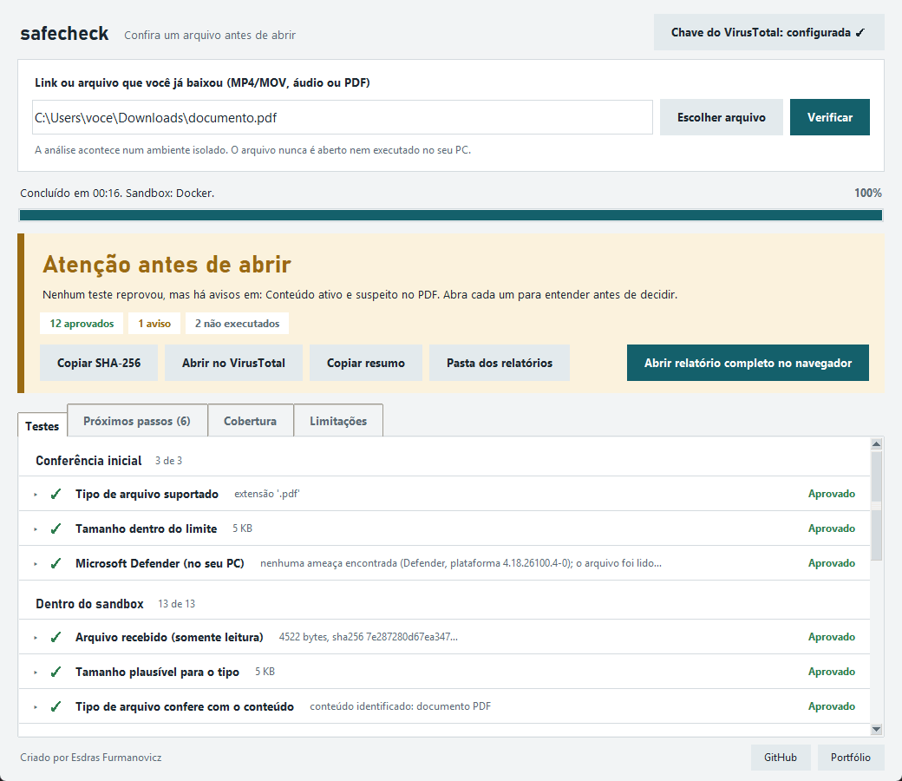
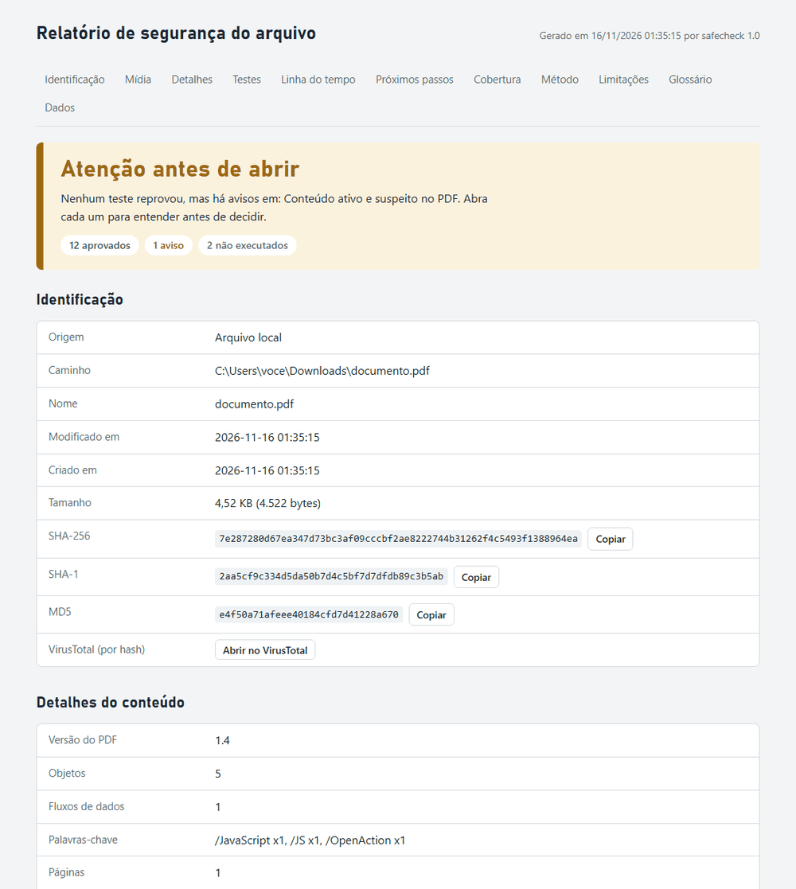

# safecheck

<p align="center">
  
</p>

<p align="center">
  <a href="https://github.com/esdrasfurmanovicz/Safecheck/actions/workflows/tests.yml"></a>
  
  
  
</p>

<p align="center"><b>Português</b> · <a href="README.en.md">English</a></p>

**Triagem local e privada de arquivos baixados, antes de abri-los.** Cole um link ou escolha um arquivo, e o safecheck o analisa dentro de um sandbox descartável (um contêiner Docker): descobre o tipo pelo conteúdo, roda antivírus, regras YARA e validadores, e entrega um veredito, um relatório HTML completo e um guia do que fazer a mais. Hoje aceita **vídeo e áudio (MP4, MOV, MP3, AAC, WAV, FLAC, OGG) e PDF**.

> Projeto de portfólio. Nasceu de uma necessidade real: conferir arquivos grandes baixados de hospedagens de arquivos antes de abri-los, sem enviá-los a terceiros (o VirusTotal não aceita arquivos acima de cerca de 650 MB).

> **Aviso:** o safecheck **nunca afirma que um arquivo é seguro**. Ele registra o que foi verificado e o que não foi. Nada detectado não significa nada malicioso: malware inédito, falhas em leitores e players e o comportamento ao executar ficam fora do alcance. Use como triagem, junto com o VirusTotal, e não como substituto de um antivírus ou de bom senso.

## Por que usar

- **Privado e sem limite prático de tamanho.** O arquivo nunca é enviado a terceiros. Só o hash (SHA-256) vai ao VirusTotal, e só se você configurar uma chave. Arquivos de vários GB funcionam (o limite do programa é 3 GB).
- **Não confia na extensão.** O tipo vem do conteúdo: um `.mp3` que na verdade é PDF, executável, ZIP ou página HTML é recusado como disfarce.
- **Várias camadas, e mostra onde elas discordam.** ClamAV, Microsoft Defender (no seu PC), regras YARA, validadores de cada formato e ferramentas de segunda opinião.
- **Honesto sobre os limites.** Todo relatório lista o que foi testado, o que ficou de fora e o que fazer a mais, conforme o seu caso.
- **Download conferido.** Se a análise foi por link, o programa baixa o arquivo no seu PC e só conclui se o SHA-256 for idêntico ao do arquivo analisado.

## Começando

**Requisitos**

- **Python 3.11 ou mais novo.** Só biblioteca padrão, sem `pip install`. A janela usa o Tkinter, que já vem no Python para Windows e macOS (no Linux: `python3-tk`).
- **[Docker Desktop](https://www.docker.com/products/docker-desktop/)**, aberto e rodando. É o sandbox que cobre todos os tipos e todos os testes. Alternativa para MP4 e MOV: o Windows Sandbox (Windows Pro ou Enterprise).
- Opcionais: o Microsoft Defender do Windows (segundo motor de antivírus) e uma chave gratuita do [VirusTotal](https://www.virustotal.com/).
- Testado no **Windows 11 com Docker Desktop**. Linux e macOS devem funcionar com Docker, mas não foram testados.

**Instalação e uso**

```bash
git clone https://github.com/esdrasfurmanovicz/Safecheck.git
cd Safecheck
python safecheck_gui.py        # abre a janela (no Windows, dê duplo clique em safecheck.pyw)
```

Cole um link ou use **Escolher arquivo**, e clique em **Verificar**.

> A **primeira análise constrói a imagem Docker** do sandbox (ClamAV, ffmpeg, YARA e outras ferramentas, cerca de **1,4 GB**) e leva vários minutos. Precisa de internet. As próximas são rápidas.

> A interface e os relatórios estão em português (pt-BR).

## Como usar

**Janela.** A lista de testes aparece de antemão, agrupada por fase, com percentual e tempo. Cada teste é marcado (✓ ✗ ! –) assim que termina, e um clique (ou Enter) abre o que ele faz e o resultado. No fim aparece o cartão de veredito, com ações (copiar o SHA-256, abrir no VirusTotal, copiar o resumo, abrir a pasta dos relatórios e o relatório completo no navegador) e as abas Testes, Próximos passos, Cobertura e Limitações. Testes reprovados ou com aviso já abrem sozinhos.

**Terminal.**

```bash
python safecheck.py "https://www.mediafire.com/file/.../documento.pdf/file"   # por link
python safecheck.py "C:\Users\voce\Downloads\musica.mp3"                      # arquivo já baixado
python safecheck.py --open "..."      # abre o relatório HTML no navegador ao terminar
python safecheck.py --reports PASTA   # grava os relatórios em outra pasta
```

**Chave do VirusTotal.** O botão **Chave do VirusTotal** (canto superior direito) permite colar, testar, salvar e remover a chave gratuita. No Windows ela é guardada **criptografada com a sua conta** (DPAPI); em outros sistemas, em um arquivo com permissão restrita, sem criptografia. A variável `VT_API_KEY` tem prioridade. A chave nunca vai para o sandbox.

**Baixar o arquivo verificado.** Quando a análise foi por link e nenhum teste falhou, o cartão de veredito mostra um botão de baixar: **verde** se tudo passou, **âmbar** ("Baixar mesmo com avisos") se houve avisos. O clique **pede confirmação**; com avisos, a pergunta lista cada aviso e a resposta padrão é "Não". O programa baixa com retomada, grava em `.part` e só conclui se o SHA-256 bater com o do arquivo analisado (senão apaga e bloqueia). No Windows, o Defender escaneia o arquivo salvo.

**Onde ficam os dados.** Relatórios (`.html` e `.json`): `%LOCALAPPDATA%\safecheck\reports` no Windows e `~/.local/share/safecheck/reports` no Linux e macOS, fora do repositório (a janela tem o botão **Pasta dos relatórios**). Chave: `%APPDATA%\safecheck\config.json` ou `~/.config/safecheck/config.json`.

## Tipos suportados

O tipo é detectado pelo **conteúdo** (bytes iniciais), não pela extensão.

| Formato | Situação |
|---|---|
| MP4, MOV, M4V, M4A | **pronto** |
| MP3, AAC, WAV, FLAC, OGG | **pronto** |
| PDF | **pronto** |
| Office (DOCX, XLSX, PPTX, DOC, XLS), RTF | planejado (macros, modelos remotos, objetos OLE) |
| ZIP, RAR, 7z | planejado (listar sem extrair; bombas de descompressão, executável dentro) |
| MKV, WebM, AVI | planejado |
| Imagens (JPG, PNG, GIF, WebP, SVG) | planejado |
| **EXE, MSI, APK, DMG, scripts (`.js`, `.vbs`, `.ps1`, `.bat`), atalhos `.lnk`, ISO** | **recusados de propósito**: só análise estática dá falsa segurança nesses casos. O programa avisa e indica o VirusTotal e o Defender |

## O que é verificado

| Etapa | O que roda |
|---|---|
| **No seu PC, antes de baixar** | HTTPS, domínio sem IP/punycode/usuário na URL, DNS público, redirecionamentos só por HTTPS, tipo e tamanho anunciados. Em arquivo local: extensão, tamanho e o **Microsoft Defender** (ele lê o arquivo, não o abre) |
| **MP4, MOV, M4A** | estrutura de caixas, tabelas internas (contagens impossíveis, offsets fora do arquivo), metadados, `ffprobe` e decodificação de amostra |
| **Áudio** | quadros e blocos coerentes com o tamanho, dados anexados ou lixo no meio, tags ID3 malformadas, capas que não são imagem, decodificação completa, `flac -t`, `mp3val`, `ogginfo` |
| **PDF** | cabeçalho e `%%EOF`, estrutura, conteúdo ativo (`/JavaScript`, `/OpenAction`, `/Launch`, anexos, nomes ofuscados, links suspeitos), fluxos compactados **abertos com limites rígidos** (proteção contra bomba de descompressão), `qpdf`, `mutool`, `pdfinfo`, `pdfdetach` |
| **Todos** | tipo pelo conteúdo vs. extensão, executável ou RAR embutido, **ClamAV** (também avisa de documento criptografado e de arquivo que passou de um limite), **regras YARA** da comunidade (com o deslocamento onde casaram), `exiftool`, e de segunda opinião: `file`, `binwalk`, `pdfid`, `pdf-parser`, `pdfresurrect`, `steghide` (WAV), `ssdeep` |
| **VirusTotal** | consulta pelo hash. Um hash que o VirusTotal "nunca viu" é só informativo |

## Como funciona e segurança

```
link ou arquivo ─▶ validação no PC ─▶ sandbox Docker (download + testes) ─▶ VirusTotal (só o hash) ─▶ veredito + relatório
```

- O sandbox é um contêiner **descartável**, sem root, sem capabilities, com sistema de arquivos somente leitura, limite de memória (3 GB) e de processos. A rede fica ligada, porque é necessária para baixar o arquivo e atualizar as assinaturas do ClamAV.
- Um arquivo local entra no sandbox por hard link, montado **somente para leitura**. Ele nunca é aberto nem executado no seu PC.
- O relatório e a janela só leem o que o sandbox devolve (um JSON). Nada que veio do arquivo é executado.

| O que sai do seu computador | Para onde |
|---|---|
| O link (para baixar dentro do sandbox) | o servidor do arquivo |
| O SHA-256 do arquivo (só se houver chave) | VirusTotal |
| Atualização das assinaturas do ClamAV | servidores do ClamAV |
| Download de pacotes e regras na construção da imagem | repositórios do Debian e do GitHub |
| **O arquivo** | **nunca** |

## Relatório

Cada análise grava um relatório HTML **autocontido** (sem recursos externos, segue o modo claro ou escuro do sistema): veredito, identificação do arquivo (SHA-256, SHA-1, MD5), detalhes do conteúdo, cada teste com "o que faz" e "o que significa se reprovar", linha do tempo, próximos passos, cobertura, ambiente e método, limitações, glossário e os dados brutos. Os parâmetros do link (tokens) não entram nele.

<p align="center">
  
</p>

## Limitações

O programa **não cobre tudo**, e cada relatório traz a tabela de cobertura. Os pontos principais:

- **Malware inédito passa.** Antivírus e YARA só detectam o que já conhecem. A análise própria de PDF (conteúdo ativo) e de estrutura é o que funciona sem assinatura, mas não é completa.
- **Falhas no seu leitor ou player** (por exemplo, um vídeo feito para explorar um codec) e o **comportamento ao executar** ficam de fora: o arquivo nunca é executado nem reproduzido por inteiro.
- **PDF criptografado** não pode ser inspecionado, nem por antivírus.
- O servidor pode entregar um arquivo diferente ao sandbox do que entregaria a você (o download no PC confere o hash para pegar isso). Links com captcha ou senha não funcionam, e a resolução de páginas do MediaFire usa regex e pode quebrar se o site mudar.
- O programa **não avalia a legalidade** do conteúdo.

## Perguntas frequentes

**A primeira execução demora ou o Docker dá erro.** A imagem do sandbox é construída uma vez (vários minutos, 1,4 GB). Confira se o Docker Desktop está **aberto e rodando**: o programa avisa se não estiver.

**O download corta ou trava.** O programa espera 60 s sem dados, tenta de novo retomando do ponto onde caiu e, se o servidor cortar 3 vezes seguidas sem enviar nada, desiste e diz em que byte parou. Na janela, ele então tenta baixar pelo contêiner Docker, que usa outra rota de rede. Se as duas rotas falham, o corte vem do servidor (por exemplo, o limite do MediaFire para arquivos grandes): tente mais tarde ou em outra rede.

**Apareceu um aviso do YARA, como `maldoc_getEIP_method_1`. O que é?** É uma regra do Yara-Rules, de Didier Stevens, que procura 6 bytes típicos de shellcode em documentos. É uma heurística, não a identificação de um malware. Em **vídeo**, uma regra de documentos que casa dentro dos dados ou do índice é quase sempre coincidência e aparece só como informação; em PDF, espaço livre ou dados anexados continua sendo aviso. O relatório mostra o deslocamento exato.

**Por que meu `.exe` é recusado?** Porque só análise estática dá falsa segurança para executáveis. Use o VirusTotal e o Defender.

**O VirusTotal diz que não conhece o arquivo.** É normal em arquivos pessoais ou grandes: a consulta funcionou, mas ninguém nunca enviou aquele arquivo. Não indica problema, e também não confirma que está limpo.

## Testes e desenvolvimento

```bash
python -m unittest discover -s tests -v    # 87 testes, sem rede, sem Docker e sem tocar o Defender
```

Os testes cobrem os tipos aceitos e recusados, a detecção pelo conteúdo, os analisadores de áudio e de PDF (arquivos sintéticos), o veredito, o VirusTotal e o Defender (simulados), a chave, o download (retomada, travamento, hash errado, cancelamento) e o relatório HTML. Rodam no GitHub Actions em Ubuntu e Windows.

Fora da suíte automática, validei à mão com o Docker: áudio e MP4 reais com adulterações, PDFs com padrões de ataque (esses o antivírus do computador barra no disco, por isso só rodam dentro do contêiner), ClamAV, YARA, validadores e ferramentas de segunda opinião, o fluxo completo com cada tipo e a janela. **Não testado:** o Windows Sandbox, Linux e macOS.

| Arquivo | Papel |
|---|---|
| `safecheck.py` | núcleo e terminal: validação do link, escolha do sandbox, plano de testes, veredito, próximos passos |
| `safecheck_gui.py`, `safecheck.pyw` | janela Tkinter |
| `guest_linux.py`, `guest_audio.py`, `guest_pdf.py` | rodam **dentro** do contêiner: download, detecção de tipo e todos os testes |
| `guest_windows.ps1` | equivalente para o Windows Sandbox (só MP4 e MOV) |
| `report_html.py`, `downloader.py`, `settings.py` | relatório, download no PC com conferência de hash, chave e pastas de dados |
| `Dockerfile`, `build_yara_rules.py`, `build_extra_tools.py` | imagem do sandbox |
| `tests/`, `.github/workflows/` | testes e CI |
| `tools/make_icon.py`, `assets/`, `docs/` | ícone (o Pillow só é preciso para gerá-lo) e capturas de tela |

## Créditos e licenças

O safecheck é licenciado sob a **MIT** (veja [`LICENSE`](LICENSE)). Ele usa, como programas separados dentro do contêiner, ferramentas de terceiros, cada uma com a sua licença: [ClamAV](https://www.clamav.net/), [FFmpeg](https://ffmpeg.org/), [poppler](https://poppler.freedesktop.org/), [qpdf](https://qpdf.sourceforge.io/), [MuPDF](https://mupdf.com/), [ExifTool](https://exiftool.org/), [YARA](https://virustotal.github.io/yara/), [binwalk](https://github.com/ReFirmLabs/binwalk), `flac`, `mp3val`, `vorbis-tools`, `file`, `pdfresurrect`, `steghide` e `ssdeep`.

Baixados na construção da imagem, **não distribuídos neste repositório**: as regras YARA de [Neo23x0/signature-base](https://github.com/Neo23x0/signature-base) e [Yara-Rules/rules](https://github.com/Yara-Rules/rules), e os scripts `pdfid.py` e `pdf-parser.py` de [Didier Stevens](https://github.com/DidierStevens/DidierStevensSuite). Verifique as licenças deles antes de redistribuir uma imagem pronta. A chave gratuita do VirusTotal é para uso não comercial, conforme os termos do serviço.

## Uso responsável

O safecheck analisa **arquivos que você tem o direito de ter**. Ele não julga a legalidade do conteúdo: um arquivo sem vírus ainda pode ser uma cópia não autorizada.

## Autor

Criado por **Esdras Furmanovicz**: [GitHub](https://github.com/esdrasfurmanovicz) · [Portfólio](https://furmanovicz.com.br)
